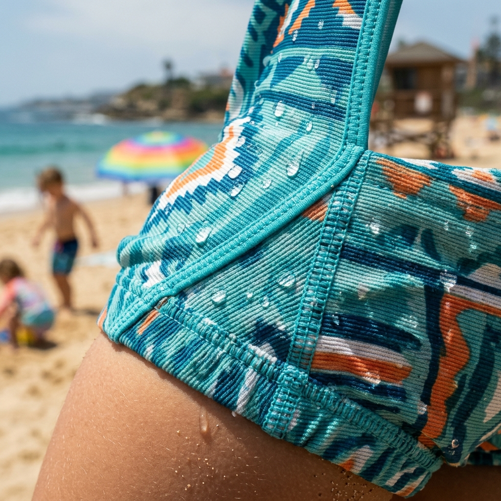

# Kids Rash Guard Size Chart for Wholesale: Questions to Set Before Sampling

A size chart can look like the least exciting page in a swimwear range—until a winning print sells through in the wrong sizes. For private-label brands and retailers, a **kids rash guard size chart wholesale** plan is the bridge between a sample that feels right and a range parents can buy with confidence.

The useful question is not, “What ages should we offer?” Age is a helpful signpost, but it is not a fit specification. A better starting point is: which body measurements, coverage expectations and growth allowances will make sense for the children and market we serve?

## Start a kids rash guard size chart wholesale brief with the wearer

Before asking a factory for a size run, define the job of the garment. A long-sleeve rash guard for outdoor beach days needs a different conversation from a short-sleeve set for swim lessons. Both must stay secure in water, but sleeve length, neckline coverage, ease through the body and the relationship between top and bottom can change the wearer’s experience.

Give the sample brief a few plain-language anchors:

- **Customer and market:** Which countries, age bands and retail channels will use the chart?
- **Use case:** Is the priority long outdoor play, regular pool lessons, holiday travel, or a mixed assortment?
- **Fit preference:** Should the rash guard feel close and streamlined, or should it leave a little more everyday ease?
- **Range architecture:** Are tops and bottoms sold as a set, and will their measurements be communicated together?

This does not replace technical development; it makes the technical questions answerable. A copied age label without a stated fit purpose is hard to explain at the point of sale.

## Use measurements before age labels

Parents often begin with age, while a dependable size guide gives them something firmer. MOMASONG’s [Size Guide & Fabric Care](https://momasong.com/size-guide) uses height, chest, waist and hip measurements across 2T through 14. That structure gives a retailer a practical sequence: check height first, compare the relevant body measurements, then use age as a supporting reference.

For a private-label program, ask to see the actual measurement points for each proposed size—not just its name. Define how each point is measured so factory, merchandising and customer-service teams read the chart the same way.

Avoid presenting another brand’s chart as your own standard. Fabric stretch, pattern shape and intended fit all affect the result. A chart earns trust when it describes the particular garment being sold.

## Size grading is a range decision, not a last-minute spreadsheet

Grading is how a pattern changes across sizes. Buyers do not need to prescribe every technical increment, but they should know what they want reviewed. Request an early discussion of how key dimensions will progress through the range, especially at transition sizes where children’s proportions can change quickly.

Three checks make the review useful:

### 1. Review coverage alongside circumference

For rash guards, sleeve and body length matter as much as chest width. Compare the fit while standing, bending and moving—not only on a static form.

### 2. Consider the fabric in the intended use

MOMASONG describes its swimwear fabric as four-way stretch and advises that swimwear should stay in place while leaving room to move. Review movement rather than rely solely on a flat table; “stretch” is not a substitute for the right size.

### 3. Plan the between-size message early

The live guide recommends sizing up when a child falls between sizes for longer wear. Whether that is right for your label should be confirmed through sampling, but the principle is valuable: decide the customer-facing advice before photography, product descriptions and staff training are finalized. A clear answer prevents different channels from improvising different fit advice.

## Make the sample review a cross-functional checkpoint

The most expensive sizing problem is the one noticed after bulk inventory arrives. Treat the sample as a decision point shared by product, merchandising and customer-facing teams. Record the style, sample size, wearer measurements, fabric, fit observations and required changes.

For custom programs, MOMASONG’s [OEM/ODM process](https://momasong.com/oem-odm) includes sample development before bulk production and notes custom waist and length sizing among its options. Bring your chart and intended fit language to that conversation.

Also keep the claim level disciplined. If a range has been sampled, say what the final approved guide covers; do not promise universal fit, or imply that a single measurement guarantees comfort for every child.

## Turn the chart into retail-ready guidance

Once the size specifications are agreed, convert them into a customer tool rather than dropping a dense factory table onto a product page. A useful listing can show the primary measurement, link to the full chart, name the intended fit, and explain what to do between sizes. For rash guard sets, show whether the recommendation applies to both pieces.

Store teams need the same version: measure first, use height and body measurements over age alone, and consult the relevant style guide. The customer should not hear one answer on a listing and another in a shop.

## Frequently asked questions

### Should a wholesale kids rash guard chart use age or measurements?

Use age as a helpful reference, but lead with measurements. Height and the relevant body measurements make the advice more useful when children of the same age have different proportions.

### How should a child’s rash guard fit?

It should stay in place in water while allowing the child to bend and play comfortably. Check the guidance for the exact style, since sleeve length, cut and fabric affect the intended fit.

### Can a private-label brand request custom sizing?

Discuss the target size range and any waist or length requirements during development. MOMASONG’s OEM/ODM page lists custom waist and length sizing; final specifications should be confirmed through the sample process.

## Build the chart before the launch calendar

The strongest **kids rash guard size chart wholesale** strategy is not more rows of numbers. It is a shared decision about wearer, use, measurements and fit language—tested before production and presented consistently afterward. When your next range is ready for development, use MOMASONG’s [size guide](https://momasong.com/size-guide) as a reference point, then [contact the team](https://momasong.com/contact) to discuss the sample and sizing questions specific to your brand.
