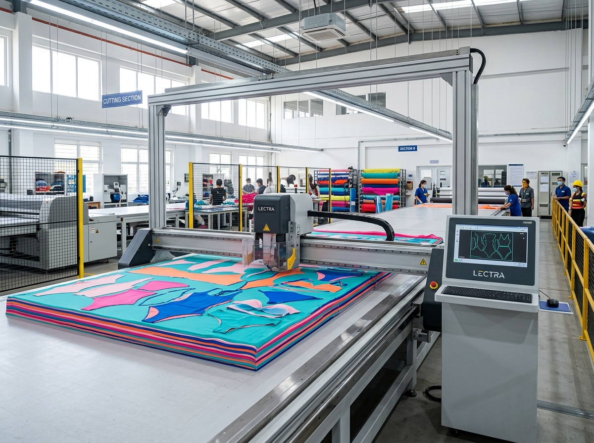
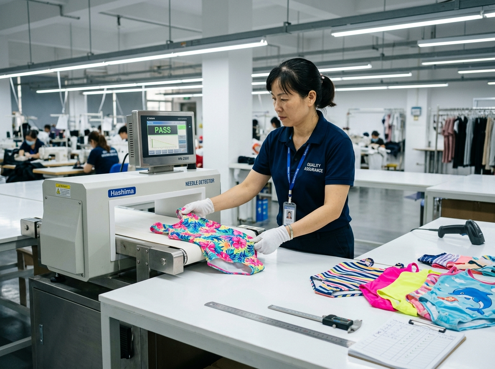

# Kids Swimwear Quality Control Checklist for Retail Buyers

Quality control sounds simple until a buyer has to approve a children's swimwear order across several colors, sizes and prints. A sample can look promising, but the real question is whether the bulk order keeps the same fit, fabric hand feel, stitching, trims and packaging discipline.

This **kids swimwear quality control checklist** is written for retailers, wholesalers and private-label teams that want more useful supplier conversations. It does not replace a formal inspection standard. It gives your buying team a practical way to ask sharper questions before production, during sewing and before shipment.

## Start With the Approved Sample

The approved sample is the reference point for the whole order. Before bulk production begins, confirm which sample version is approved, which fabric is locked, which trims are final and which measurements matter most for each size.

For children's swimwear, small differences can affect comfort. A neckline that sits too high, a waistband that feels too tight or a rash guard sleeve that loses its intended length can create customer service problems later. Keep one signed or clearly documented approval sample for comparison, and make sure the factory understands that it is the control standard, not just a design example.

MOMASONG's [OEM/ODM process](https://momasong.com/oem-odm) describes a workflow from inquiry and design quotation through sample development, bulk production, quality check and delivery. That structure helps buyers separate design approval from production control instead of treating them as one step.

## Check Fabric Before Cutting

Fabric inspection is the first real quality gate. Once fabric is cut, problems become more expensive to correct. MOMASONG's [quality page](https://momasong.com/quality) describes incoming fabric inspection for colorfastness, weight and elasticity before cutting, which is exactly the kind of checkpoint buyers should ask about.

Useful fabric questions include:

- Is each fabric batch checked before cutting?
- Are print colors compared against the approved sample or artwork?
- Are stretch, recovery and hand feel reviewed before sewing begins?
- Are lining and opacity checked for the intended age group and color?
- Are any UPF, recycled-material or performance claims tied to the approved fabric for this order?

Avoid vague approval language such as "fabric is good." Ask what was checked, who checked it and how the result is recorded. For private-label orders, this is also the moment to confirm whether claims planned for product pages, labels or hangtags are supported by the current order specification.

*Fabric review before cutting gives buyers an earlier chance to catch color, weight or elasticity issues.*

## Review Sewing and Construction While Production Is Running

Final inspection matters, but it should not be the first time anyone studies the product closely. In-line checks are useful because they catch repeated mistakes while the sewing line can still adjust.

MOMASONG states that designated QC checkers review sewing-line stitching details, seam alignment and flatlock construction. For a buyer, those are not just factory words; they are points to turn into questions.

Ask the supplier to explain how it checks:

- seam alignment on printed panels and color-blocked styles;
- elastic tension at waistbands, leg openings and necklines;
- zipper glide, zipper guards and puller placement when used;
- decorative details such as buttons, patches, ruffles or bows;
- size consistency across the full graded range;
- comfort points that touch a child's skin.

Children's swimwear has to move. A clean-looking seam still needs to feel comfortable when a child reaches, sits, swims and plays. If your range includes rash guards, two-piece sets, swim dresses or accessories, review the details style by style instead of assuming one inspection method fits the full assortment.

## Build a Clear Final Inspection List

Final inspection should answer a practical buying question: would this order be acceptable if it arrived in your warehouse today?

MOMASONG's quality page describes final manual checks for thread trims, zipper glide, buttons and decorative detailing. Use that as a starting point, then add the details your brand needs for its own retail channel.

*A final inspection should confirm the garment, trims and finishing details before packing.*

A retail-ready final checklist should cover:

### Measurements and Fit

Confirm the tolerance for each key measurement and check samples across sizes, not only one middle size. Pay attention to chest, waist, hip, torso length, sleeve length, inseam and strap placement where relevant. If your brand uses its own size chart, keep that chart attached to the inspection file.

### Appearance and Color

Check print placement, color consistency, fabric defects, stains, loose threads and visible asymmetry. Swimwear often uses bright prints, so color variation can be easy for customers to notice in a retail rack or online product gallery.

### Trims and Labels

Confirm woven labels, care labels, hangtags, zipper details, drawcords, decorative patches and packaging labels. For private-label buyers, branding errors can be as damaging as garment defects because they delay selling even when the product itself is usable.

### Packing and Cartons

Review size and color ratios, individual packaging, carton labels and any retailer-specific packing instructions. A well-made order can still create operational friction if cartons arrive with unclear labels or mixed stock.

## Keep Safety and Performance Claims Specific

Buyers should be careful with broad claims. MOMASONG's website references safety standards, fabric checks, UPF 50+ protection and performance testing, but a buyer still needs style-level confirmation for the exact order being developed.

The practical rule is simple: do not copy a claim into a product page, packaging file or retailer document until the supplier confirms that it applies to the approved fabric and style. This protects the retailer, the factory and the end customer. It also makes the product story more credible because every claim is tied to a real specification.

## Turn the Checklist Into a Supplier Conversation

A useful checklist is not a trap for the factory. It is a shared working document. Send it before sampling or before bulk production starts, and ask the supplier to mark which checkpoints are standard, which require extra testing and which need buyer approval.

For MOMASONG OEM/ODM projects, the best starting brief includes the product type, age range, size chart, artwork, fabric preference, trims, label needs, packaging requirements and target delivery window. With those details in place, the quality conversation becomes more concrete: fabric can be checked against the right standard, construction can be reviewed against the intended use and final inspection can focus on what the retailer actually needs to sell.

## Frequently Asked Questions

### What should be included in a kids swimwear quality control checklist?

Include the approved sample, fabric checks, color and print review, sewing construction, measurements, trims, labels, packaging, final inspection records and any order-specific performance claims.

### Is final inspection enough for children's swimwear?

No. Final inspection is important, but fabric inspection and in-line production checks help catch problems earlier, before the entire order is finished.

### Can one checklist cover every style?

Use one base checklist, then add style-specific points. A rash guard, ruffle two-piece, swim dress and zip-up style will not have identical risk points.

### What should private-label buyers confirm before using performance claims?

Confirm that the claim applies to the approved fabric, construction and style for that order. Keep the supporting specification or test information with the product record.

## Plan Quality Before the Order Is Urgent

A strong **kids swimwear quality control checklist** gives buyers a better way to compare suppliers and manage production risk. It turns "good quality" into visible checkpoints: fabric, fit, stitching, trims, labels, packing and final review.

To discuss a children's swimwear order with sample development, OEM/ODM production and quality checkpoints in view, [contact MOMASONG](https://momasong.com/contact) with your product brief, size range, artwork and target launch timeline.
