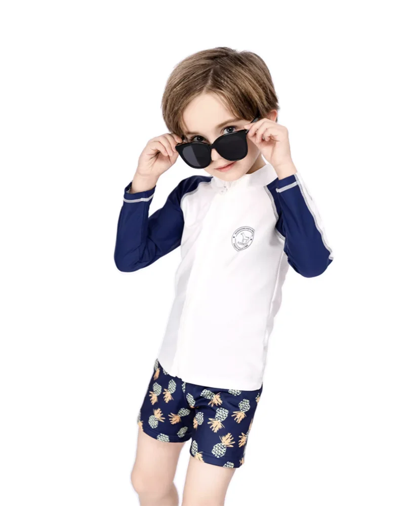

# Kids Swimwear Care Instructions: What Retail Buyers Should Put on Product Pages

Care instructions are not an afterthought in children’s swimwear. They are part of the product experience. A parent may choose a bright rash guard or two-piece set for the print, but the garment has to survive pool water, sunscreen, sand, repeated rinsing and the usual hurry of family travel.

Clear **kids swimwear care instructions** help retailers reduce avoidable complaints, train staff more consistently and keep product claims grounded in the approved garment information. The goal is not to make care sound complicated. It is to give families a simple routine they can follow after every swim.

## Why Care Copy Belongs Near the Buying Decision

Many product pages hide care guidance at the bottom, or rely only on the garment label. That is a missed opportunity. Care instructions can answer a customer’s quiet concern before checkout: will this product still look and feel good after real use?

For retailers and private-label buyers, care copy should appear in three places:

- the product page, where shoppers compare styles;
- the garment label or care tag, where families check after purchase;
- after-sale emails, inserts or FAQ content, where customer service can reduce repeat questions.

The language should be short, specific and consistent. If the product page says one thing and the care label says another, the customer is left guessing.

*Fabric and quality information should support care guidance, not replace it.*

## Start With the After-Swim Routine

MOMASONG’s [Size Guide & Fabric Care](https://momasong.com/size-guide) gives practical care guidance: rinse swimwear in cold water after each use, hand wash with mild detergent, avoid bleach and fabric softener, hang dry in the shade, and avoid tumble drying, ironing and rough surfaces.

That routine can be translated into retail copy without sounding technical:

### Rinse Promptly

Tell families to rinse swimwear in cold water after pool, beach or splash-park use. This is easy to understand and fits real life: the garment should not sit wet in a bag for the rest of the day if the family can avoid it.

### Wash Gently

Hand washing with mild detergent is a clear instruction. Avoid wording that implies the garment can take any wash cycle unless that has been confirmed for the specific product and label.

### Dry Away From Harsh Heat

Shade drying is more useful advice than a vague “dry carefully” note. It also gives staff a simple answer when customers ask why tumble drying or ironing is not recommended.

### Protect the Surface

Rough pool edges, Velcro, concrete and sharp surfaces can affect swimwear. This is practical parent-facing advice, especially for active children who sit, slide and climb between swims.

## Keep Claims Separate From Care

Care instructions should support product performance, not exaggerate it. MOMASONG’s [Quality page](https://momasong.com/quality) describes premium fabrics, strict QC controls and durability-related checks. Its live pages also reference features such as UPF 50+, quick-dry, chlorine resistance and fabric testing.

Those facts are useful, but a retailer should still confirm which claims apply to the exact SKU before writing product copy. A care guide should not turn into a blanket promise that every style will resist every condition. Better wording is specific and modest:

- “Rinse after pool or beach use.”
- “Follow the care label for best results.”
- “Use only the approved claims for this style.”
- “Avoid bleach, softener, high heat and rough surfaces.”

This protects the customer relationship. Families trust care guidance when it feels practical rather than promotional.

## Connect Care Instructions With Fit Guidance

Care and fit often meet in customer service. A suit that is too small may feel strained; a suit that is too large may move around in water. MOMASONG’s size guide uses height, chest, waist and hip measurements from 2T through 14 and recommends sizing up when a child falls between sizes for longer wear.

*Fit guidance and care guidance work together: the customer needs both before and after purchase.*

For retailers, this means the care block should link naturally to size guidance. A useful product page might say: “Choose the correct size first, then rinse and dry the garment according to the care label after each swim.” That keeps the advice realistic. Care cannot fix a poor fit, and fit guidance cannot replace proper washing and drying.

## What Private-Label Buyers Should Confirm

For a private-label kids swimwear order, the care conversation should happen before packaging is finalized. Ask the supplier to confirm:

- the approved fabric and lining information;
- the exact care-label wording;
- whether any product-specific warnings are needed;
- how labels, hangtags and packaging should present care;
- which performance claims are approved for the order;
- whether the care copy differs across swimwear, hats, towel ponchos or water shoes.

MOMASONG’s [OEM/ODM process](https://momasong.com/oem-odm) includes inquiry, design and quote, sample development, bulk production, quality check and delivery. Use that process to align care wording before bulk production, not after cartons are packed.

## Turn Care Copy Into a Retail Asset

Care guidance can help merchandising when it is written clearly. A short “after swimming” panel works well on product pages, especially for rash guards, two-piece sets and accessories. It can also be useful in seasonal content such as beach-day checklists and pool-party packing guides.

Avoid long blocks of generic textile language. Parents are more likely to follow care advice when it feels direct:

1. Rinse in cold water after use.
2. Hand wash with mild detergent.
3. Hang dry in the shade.
4. Keep away from bleach, softener, tumble drying, ironing and rough surfaces.

That sequence is easy for staff to repeat and easy for families to remember.

## Frequently Asked Questions

### What are the most important kids swimwear care instructions?

Rinse after use, hand wash gently, dry in the shade and avoid bleach, fabric softener, tumble drying, ironing and rough surfaces. Always follow the final garment care label.

### Should care instructions appear on product pages?

Yes. Product-page care guidance helps parents understand maintenance before purchase and gives customer service a consistent reference after purchase.

### Can all kids swimwear use the same care copy?

Use a shared basic routine only when it matches the approved garment label. Confirm style-specific details for custom fabrics, trims, accessories and private-label packaging.

### How can retailers reduce care-related returns?

Keep care wording visible, specific and consistent across product pages, labels, inserts and support replies. Avoid overpromising durability or performance.

## Make Care Guidance Part of the Product Story

The best **kids swimwear care instructions** are simple enough for families and precise enough for retail teams. They protect the garment, reduce confusion and make the product feel more trustworthy after checkout.

To discuss care labels, product pages, private-label packaging or wholesale kids swimwear development, [contact MOMASONG](https://momasong.com/contact) with your collection brief and target launch plan.
