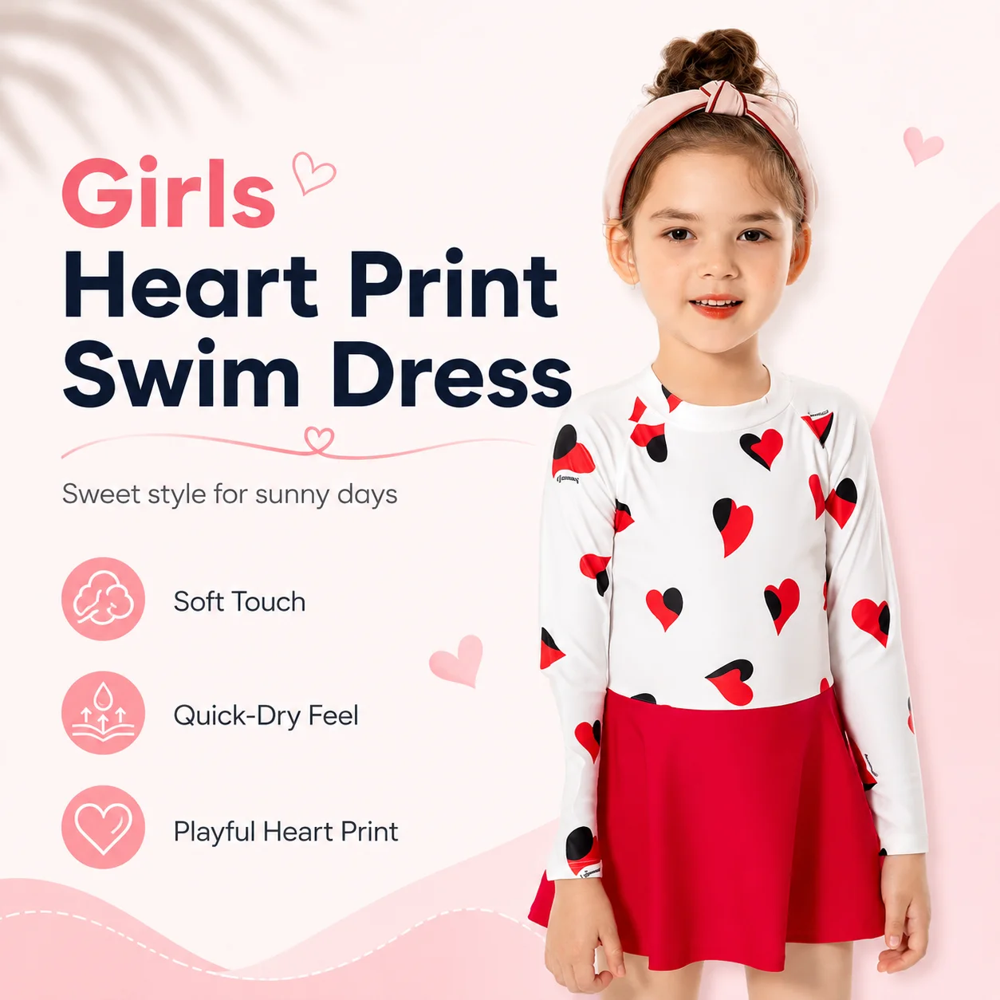
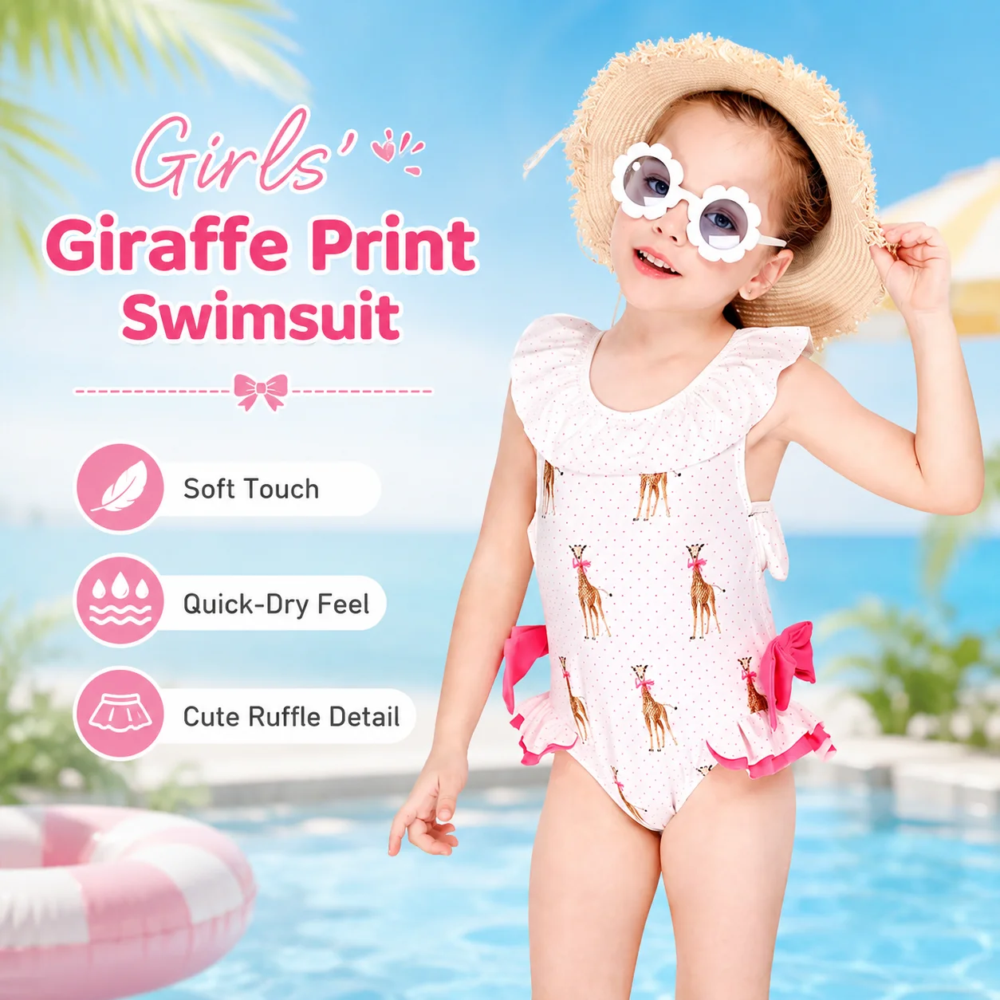

# Kids Pool Party Swimwear: A Retail Buyer’s Guide to a Smarter Summer Edit

A pool party is not the same shopping moment as a quiet swim lesson. Children are moving between water, snacks, games, photos, pool decks and quick towel breaks. Parents want the outfit to look fun, stay comfortable and survive a busy afternoon without turning into a packing problem.

That makes **kids pool party swimwear** a useful retail theme. It gives buyers a way to build a summer edit around a clear occasion, instead of presenting swimwear as a wall of unrelated styles. The best edit is not the biggest one. It is the one a parent can understand quickly: what the child wears in the water, what helps around the pool and what makes the day easier to manage.

## Start With the Pool Party Use Case

Before choosing prints, define the customer problem. A pool-party assortment usually needs to answer four practical questions:

- Will the swimwear stay comfortable while children play actively?
- Is there enough coverage for outdoor pool time where the approved product specification supports that story?
- What accessories help children move safely around wet poolside areas?
- Can parents understand the fit, care and packing advice without reading a long technical description?

For retailers and private-label brands, this turns a lifestyle theme into a buying brief. Instead of ordering one of every style, select a small group of products that work together across the full day.

## Choose One Hero Swimwear Shape

A hero style gives the edit a center. For pool parties, a rash guard set is often easy to explain because it combines a swim top and bottom in one clear outfit. MOMASONG’s product range includes rash guard sets, two-piece sets, one-piece styles and accessories in its [shop](https://momasong.com/shop), giving buyers several ways to build a pool-focused story.

The product page for the Girls Shark Print Rash Guard Set - Aqua Dream lists the style as factory-direct wholesale with custom OEM/ODM available, UPF 50+ and two color options. Use those details carefully: they are helpful product-page facts, but any retailer-facing claim should still be checked against the exact approved order specification before final copy or packaging is released.

*Girls Shark Print Rash Guard Set - Aqua Dream. Source: [MOMASONG product page](https://momasong.com/products/lw-sw13.html).*

For merchandising, place the hero set where the occasion is obvious. A “pool party ready” display can lead with one strong print, then show the nearby add-ons that solve the rest of the day.

## Add Accessories That Make Poolside Movement Easier

Accessories should earn their place. At a pool party, one of the easiest add-ons to explain is a pair of water shoes. Pool decks, splash areas and changing zones can be slippery or uncomfortable underfoot, so footwear has a practical role beyond color coordination.

MOMASONG’s Kids Quick-Dry Water Shoes - Jungle Leaf product page lists the item as factory-direct wholesale with custom OEM/ODM available. For a retailer, the important task is to confirm the available sizes, closure style, sole details, material information, packaging and care instructions before building the final assortment.

*Kids Quick-Dry Water Shoes - Jungle Leaf. Source: [MOMASONG product page](https://momasong.com/products/lw-sw16.html).*

Do not force every accessory into the same print family. A coordinated color direction may be easier to buy, display and replenish than a perfect match for each swimsuit.

## Use Fit Guidance as a Conversion Tool

Pool-party purchases are often made for a specific date. That raises the cost of a poor fit: parents may not have time to exchange before the event.

Link shoppers to the [MOMASONG Size Guide](https://momasong.com/size-guide) from pool-party content and product pages. In store, turn the same guidance into a short staff prompt: measure first, check height and body measurements, and make sure the child can move comfortably before the event.

For buyers developing a private-label range, ask the factory how the size chart, sample approval and bulk measurement checks will connect. A great pool-party edit is not only attractive; it is reliable enough that parents can buy ahead with confidence.

## Keep Copy Specific and Parent-Friendly

Pool-party copy should sound like a useful store associate, not a fabric lab report. Parents want fast answers:

- What is this style best for?
- How much coverage does it offer?
- What should I pair it with?
- How should I rinse and dry it after the party?

MOMASONG’s [Size Guide & Fabric Care](https://momasong.com/size-guide) includes care guidance such as rinsing after use, hand washing with mild detergent, drying in the shade and avoiding bleach, softener, ironing and tumble drying. Bring those instructions closer to the buying moment with a short “after the party” care note. It helps families protect the garment and gives the retailer a more complete service story.

## Build the Wholesale Order Around a Tight Edit

A pool-party theme can become scattered if the order includes too many unrelated styles. Keep the first wholesale edit focused:

1. One or two hero swimwear silhouettes.
2. A practical accessory such as water shoes.
3. A small color story that works across sizes.
4. Clear fit and care guidance.
5. Packaging and label details that match the retail channel.

Before confirming a **pool party swimwear wholesale** order, review MOQ, color options, size breakdown, sample approval, labels, packaging and production timing in writing. MOMASONG’s [OEM/ODM page](https://momasong.com/oem-odm) describes a process that includes inquiry, design and quote, sample development, bulk production, quality check and delivery. Use that workflow to keep the lifestyle idea connected to real production decisions.

## Make the Pool Party Story Easy to Shop

The strongest retail presentation gives parents a small decision path: choose the hero swimwear, add the practical poolside item, check the size, then understand the after-swim care. That is enough. A clear pool-party story should reduce friction, not add more choices to compare.

For online merchandising, use one landing section, one hero product, one accessory add-on and direct links to size guidance and contact support. For wholesale showrooms, group the same items physically so the story is visible without explanation.

## Frequently Asked Questions

### What makes good kids pool party swimwear?

Good pool-party swimwear should be comfortable for active play, easy for parents to understand and supported by clear fit and care information. Coverage and performance claims should match the approved product specification.

### Should retailers sell accessories with pool-party swimwear?

Yes, when the accessory solves a real poolside need. Water shoes are a practical example because they support movement around wet or warm pool areas.

### How many styles should be in a pool-party edit?

Start small. One or two hero swimwear styles plus a practical accessory and clear size guidance can be stronger than a large mixed assortment.

### Can a pool-party swimwear range be private label?

Yes, if the supplier supports the required customization. Confirm artwork, labels, packaging, MOQ, samples, production timing and quality checks before approving the order.

## Turn a Summer Occasion Into a Clear Buying Brief

A useful **kids pool party swimwear** edit is built around a real family day: active water play, poolside movement, quick care and easy packing. Retailers that keep the story tight can make the collection easier to buy and easier to reorder.

To discuss wholesale kids swimwear, pool-party assortments or private-label development, [contact MOMASONG](https://momasong.com/contact) with your target age range, size plan, artwork and launch timing.
