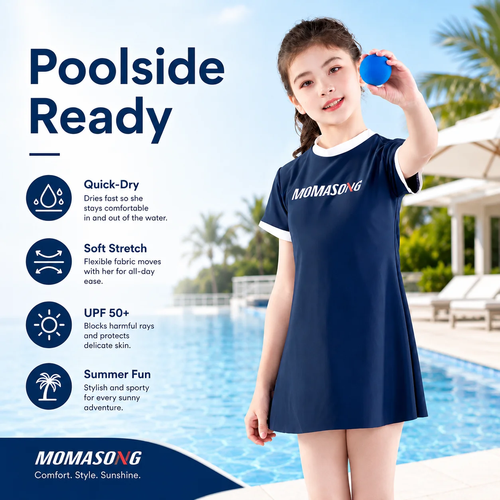

# Kids Resort Swimwear Capsule: A Retail Buyer’s Guide to a Smaller, Stronger Edit

Resort retail works differently from a broad summer shop. The customer may be buying close to travel, packing light, replacing something forgotten or choosing a practical piece for a child who wants to get back to the pool quickly. A crowded rack can slow that decision down.

A focused **kids resort swimwear capsule** gives retailers a cleaner answer. Instead of trying to show every style, it builds a small holiday-ready edit around coverage, easy coordination, fit confidence and useful add-ons. The goal is not to reduce choice for the sake of it. The goal is to make the right choice easier.

## Start With the Resort Customer’s Day

A family resort day usually moves through several small scenes: breakfast, pool time, shade breaks, beach walks, lunch, another swim and a tired walk back to the room. A capsule should support that rhythm.

For buyers, that means selecting products by job:

- a hero swimwear piece for the water;
- a coverage option for longer outdoor time;
- a small accessory that supports the same day;
- clear size and care guidance that helps parents buy quickly.

This is where a capsule differs from a general wholesale order. A general order asks, “What can we stock?” A resort capsule asks, “What helps this family get through the day with fewer decisions?”

## Choose One Hero Swimwear Shape

The hero piece should be easy to understand at first glance. A long-sleeve rash guard set can work well in a resort edit because it creates a complete swimwear outfit and gives the buyer a clear coverage story where the approved product specification supports it.

MOMASONG’s Girls Long Sleeve Rash Guard Set - Deep Sea Blue product page lists the style as factory-direct wholesale with custom OEM/ODM available, UPF 50+ and quick-dry options. The page also shows an MOQ of 800 pcs. Treat those details as product-page reference points and confirm final order terms, claims and specifications in the quotation before using them in retailer-facing materials.

*Girls Long Sleeve Rash Guard Set - Deep Sea Blue. Source: [MOMASONG product page](https://momasong.com/products/lw-sw24.html).*

For merchandising, avoid placing every rash guard style together without context. A resort display can lead with one strong set, then show only the supporting pieces that make sense with it.

## Add One Accessory With a Clear Role

In a resort shop, accessories need to be quick to understand. A wide-brim sun hat is useful because it can sit beside swimwear without competing with it. It gives the capsule an outdoor-use signal and helps the display feel like a complete holiday solution.

MOMASONG’s Kids Wide Brim UV Sun Hat - Sea Shell product page lists custom OEM/ODM availability, UPF 50+ and three color options, with an MOQ shown on the page. As with swimwear, buyers should confirm the final specification, size details, label wording, packaging and order terms before committing.

*Kids Wide Brim UV Sun Hat - Sea Shell. Source: [MOMASONG product page](https://momasong.com/products/lw-sw47.html).*

The accessory does not need to match perfectly. A related ocean palette or simple color connection can be enough. Resort shoppers often need speed and clarity more than a fully matched set.

## Keep the Capsule Small Enough to Explain

A good capsule should be easy for staff to describe in one sentence: “This is the holiday water-day edit: a swim set, a hat, size guidance and simple care instructions.” If the explanation takes longer than that, the capsule may be trying to do too much.

For a first test, consider:

1. One girls’ or boys’ hero swimwear style.
2. One practical accessory.
3. Two or three sizes with enough depth for the likely customer.
4. A clear product-page link to fit and care information.
5. A simple display name such as “Resort Pool Day” or “Holiday Water Edit.”

Retailers can then evaluate which piece creates the first click, which size sells through first and whether the accessory lifts the order value. That is more useful than launching a large assortment with no clear learning goal.

## Make Fit Guidance Visible Before Checkout

Resort and holiday purchases are often time-sensitive. Parents may not have the luxury of ordering multiple sizes and returning what does not fit. MOMASONG’s [Size Guide & Fabric Care](https://momasong.com/size-guide) uses height, chest, waist and hip measurements from 2T through 14 and recommends sizing up when a child is between sizes for longer wear.

For capsule merchandising, link size guidance close to the hero item. Do not bury it in a footer. Staff scripts, product pages and email content should all use the same advice: measure before buying, compare body measurements, and check that the child can move comfortably.

## Use Care Copy to Support the Holiday Story

A resort capsule should also tell parents what happens after the swim. MOMASONG’s size and care page advises rinsing swimwear in cold water after use, hand washing with mild detergent, drying in the shade and avoiding bleach, softener, tumble drying, ironing and rough surfaces.

That copy can be shortened for the selling moment:

- rinse after pool or beach use;
- hand wash gently;
- dry in the shade;
- avoid harsh heat and rough surfaces.

This advice is practical, not decorative. It helps a parent protect a garment during a trip, and it gives customer service a consistent answer if care questions come later.

## Plan Private-Label Development Around the Occasion

For private-label buyers, a resort capsule is strongest when the occasion is defined before artwork begins. Decide whether the capsule is for hotel boutiques, family beach resorts, cruise retail, online holiday packing or a broader summer campaign. Each channel changes the packaging, imagery, size depth and reorder plan.

MOMASONG’s [OEM/ODM process](https://momasong.com/oem-odm) covers inquiry, design and quote, sample development, bulk production, quality check and delivery. Use that workflow to align the capsule brief early: product type, artwork, color family, size range, labels, packaging and target delivery window.

## Frequently Asked Questions

### What should a kids resort swimwear capsule include?

Start with one hero swimwear style, one practical accessory, visible size guidance and clear care instructions. Add more only when the first edit has a clear role.

### Is a rash guard set useful for resort retail?

Yes, when it fits the customer and the approved product specification supports the coverage and performance story. Confirm the exact claims for the selected style before publishing copy.

### Should resort swimwear accessories match the main print?

They can, but they do not have to. A related color palette is often easier to buy, display and replenish than a perfectly matched accessory for every style.

### What should wholesale buyers confirm before ordering?

Confirm MOQ, sizes, colors, fabric details, approved claims, sample process, labels, packaging and production timing for the specific order.

## Make the Holiday Edit Easier to Buy

A strong **kids resort swimwear capsule** is not a tiny version of a full swimwear department. It is a sharper retail tool: one clear water-day story, supported by fit, care and practical add-ons.

To discuss wholesale kids swimwear, resort capsules or private-label development, [contact MOMASONG](https://momasong.com/contact) with your target customer, size plan, artwork direction and launch timing.
