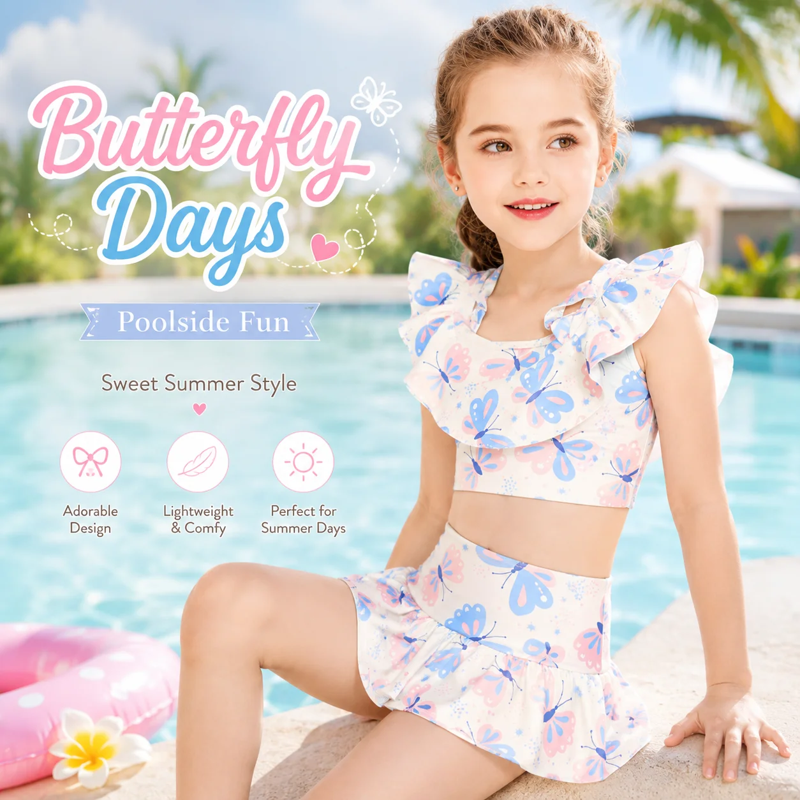

# Girls Swim Skirt Set Wholesale: The Poolside Edit Parents Can Picture

A parent rarely shops a holiday rail by fabric specification alone. They picture the first pool morning: sunscreen, a quick change, a child who wants to keep playing, and a photo they will be happy to send home. That is why a **girls swim skirt set wholesale** offer can earn its place in a retailer's summer edit. It gives a familiar two-piece silhouette a little more movement and an immediately understandable poolside story.

For a buyer, the opportunity is not to turn every swimsuit into a skirt set. It is to make a small, coherent choice easy: a style that looks at home beside rash guards, one-pieces and cover-ups, while still feeling purposeful for a beach trip, resort day or backyard pool.

## Start with the moment the customer is buying for

The strongest lifestyle merchandising begins with an occasion, not a generic colour story. A girls swim skirt set can work especially well in a “poolside fun” section because it helps a shopper imagine an outfit rather than a single garment. The nearby products should answer the rest of the day: a cover-up or towel for the walk back, a sun hat for time away from the water, and a rash guard option for families who prefer more arm coverage.

This does not mean promising that one set suits every activity. It means giving customers a clear way to choose. A retailer can position a skirted two-piece as the playful, coordinated option; a rash-guard set as the coverage-led choice; and a one-piece as the streamlined alternative. That comparison reduces the “what is the difference?” question before it reaches the checkout.

MOMASONG's [shop collection](https://momasong.com/shop) already groups girls swimwear, two-piece sets, rash guards and swim accessories. Use those categories as the bones of a landing page, catalogue spread or retail display rather than placing every girls' style into one undifferentiated row.

## Make a girls swim skirt set wholesale assortment feel intentional

An effective wholesale assortment needs fewer repeated ideas and more useful contrasts. Begin with a limited run of print directions—perhaps a soft floral, an ocean-inspired graphic and a brighter holiday print—then make sure each earns a distinct role. One can be the campaign image, one the easy everyday pool choice, and one the bolder vacation option.

Next, think in outfits. A swim skirt adds visual movement, so it benefits from a top that feels balanced rather than busy. Buyers should ask for clear imagery of the full look, front and back, plus close-ups of the print and finish. Those images serve both line review and later product-page storytelling. They also prevent the common problem of a beautiful catalogue image that does not explain what is included.

### Keep fit guidance practical, not decorative

For children's swimwear, a charming silhouette cannot replace usable size information. Link from the product page to a clear fit resource and encourage shoppers to measure rather than guess. MOMASONG's [size guide](https://momasong.com/size-guide) provides height, chest, waist and hip references and advises sizing up when a child is between sizes for longer wear.

That guidance has a merchandising payoff: it gives customer-service teams a consistent answer and helps a parent feel supported before the first pool day. When building a private-label range, decide early how the size presentation, hangtags and product-page copy will make those measurements easy to find.

## Build the set around real beach-to-pool behaviour

The best poolside edit accounts for transitions. Children sit on a towel, head to a snack bar, move through shade and sun, and jump back into the water. Retailers can make the range more useful by offering adjacent choices instead of treating the swimsuit as a solitary purchase:

- Pair a skirted set with a soft layer for walking to and from the water.
- Cross-merchandise a wide-brim hat or another swim accessory nearby, rather than hiding accessories on a separate page.
- Include a rash guard alternative in the same print family when the range supports it, so families can choose coverage without abandoning the look they like.
- Use real product imagery and concise “what's included” copy; do not imply accessories are part of the set unless they are.

This is also where a brand can express its point of view. The most useful girls' beachwear edit is not the one with the most options; it is the one in which every option has a job. A compact collection is easier for a retailer to explain, photograph and replenish.

## Use development conversations to protect the retail story

If the goal is a branded collection rather than ready-to-ship selection, bring the retail idea into the development brief. Describe the intended customer, the use occasion, the preferred print direction, the size presentation and any coordinated pieces. MOMASONG's [OEM/ODM process](https://momasong.com/oem-odm) outlines a workflow from inquiry and design through sample development, quality checks and delivery; it is a useful starting point for organizing those decisions.

Request a sample review that looks beyond the flat lay. Check whether the complete outfit reads clearly in photography, whether the print placement supports the silhouette, and whether the size communication is ready for a buyer or parent to understand. Keep performance and certification claims tied to the specific approved product and supporting documentation rather than assuming them from a concept board.

## Frequently asked questions

### What should a retailer show with a girls swim skirt set?

Show the full set first, then add relevant alternatives such as a rash guard, cover-up or swim accessory. Clear images and copy should distinguish optional add-ons from included pieces.

### Is a swim skirt set only for beach holidays?

No. Pool days, resort travel, water-park visits and backyard swimming are all understandable lifestyle contexts. The product page should still describe the actual garment and its intended use accurately.

### How can a private-label brand make the range cohesive?

Begin with a narrow print and colour direction, then coordinate the product imagery, fit information, labels and adjacent styles through the development brief and sample review.

## Plan the poolside story before the next buy

A thoughtful **girls swim skirt set wholesale** offer gives retailers more than another two-piece: it gives families an easy visual decision. Explore MOMASONG's [girls' swimwear and accessories](https://momasong.com/shop), then [contact the team](https://momasong.com/contact) with the occasion, assortment idea and brand requirements you want the next collection to solve.
