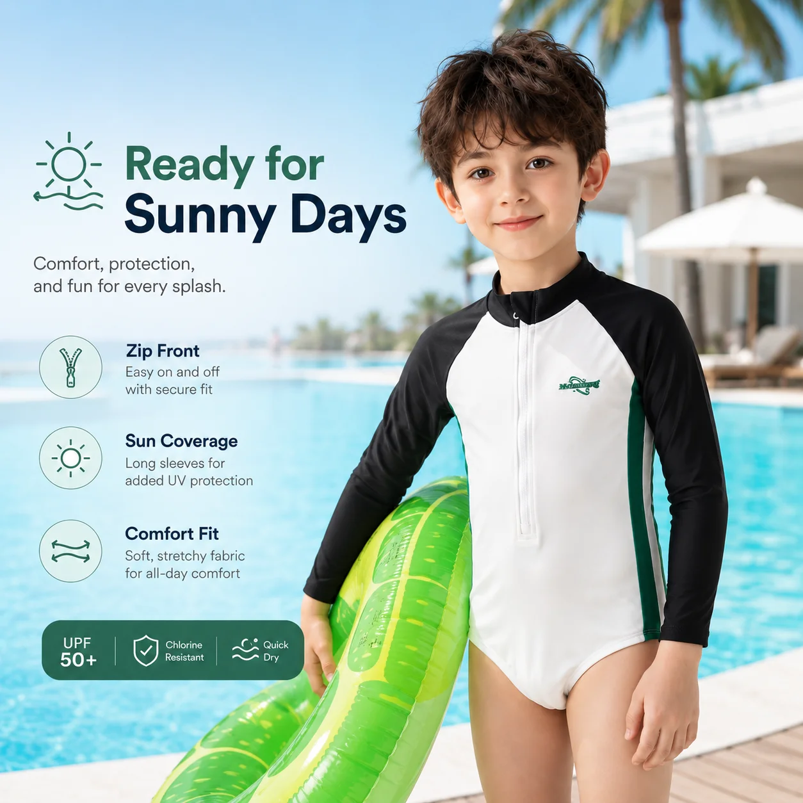
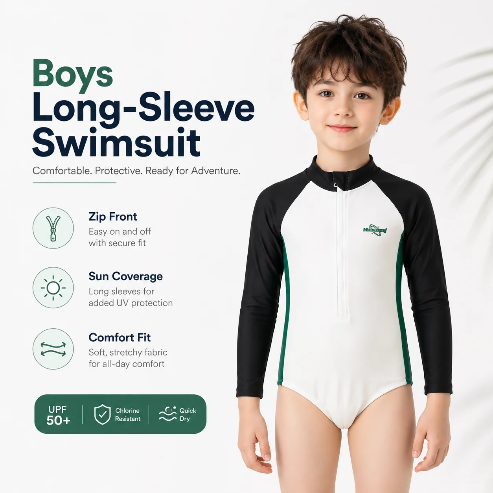

# Kids Hooded Beach Towel Poncho Wholesale: A Retail Buyer’s Product Guide

A towel poncho is easy to underestimate. It does not carry the same first-glance impact as a swimsuit print, but it often solves the part of a family water day that parents remember most: the wet, chilly, slightly chaotic transition after swimming.

That is why **kids hooded beach towel poncho wholesale** planning deserves its own product conversation. For retailers, resort shops and private-label brands, the poncho can sit between swimwear and accessories: practical enough to justify the purchase, visual enough to support a seasonal display and simple enough for staff to explain in one sentence.

## What the Product Needs to Do

A kids beach towel poncho has a clear job. It gives children a quick layer after the pool, beach or splash park, while giving parents an easier alternative to wrapping and rewrapping a standard towel. The hood adds warmth and coverage after swimming, and the pull-on shape makes the product useful around changing rooms, car parks and hotel pools.

For a buyer, that role matters because it defines where the product belongs in the assortment. It is not only a towel. It is not only a cover-up. It is a transition product that can be merchandised beside swimwear, water shoes, sun hats and travel accessories.

MOMASONG’s product page for the Kids Hooded Beach Towel Poncho - Sea Shell lists it as factory-direct wholesale with custom OEM/ODM available. The page also displays an MOQ of 900 pcs and highlights UPF 50+ and comfort fabric options. Treat those as product-page reference points, then confirm final order terms, fabric specification and approved claims in the project quotation before publishing retailer copy or packaging.

*Kids Hooded Beach Towel Poncho - Sea Shell. Source: [MOMASONG product page](https://momasong.com/products/lw-sw32.html).*

## Why Retailers Should Treat It as a Product Category

The strongest swimwear range is not limited to what children wear in the water. Families also buy for the walk back from the pool, the pause between swims, the ride home and the next day of the trip. A towel poncho gives retailers a product that connects those moments.

This makes it especially useful for:

- beach and resort shops building a full water-day edit;
- online retailers increasing average order value with practical add-ons;
- boutiques creating giftable summer products;
- private-label brands extending a swimwear print story into accessories;
- wholesale buyers testing a focused accessory SKU before adding more depth.

The product earns shelf space when it is positioned around use, not decoration. “A quick layer after swimming” is clearer than “summer essential.” Parents understand the problem immediately.

## How to Merchandise a Kids Beach Towel Poncho

The easiest mistake is to put towel ponchos in a separate towel section where swimwear shoppers never see them. If the goal is cross-selling, the product should sit near the occasion it supports.

For a retail floor, place the poncho near rash guard sets, swim dresses or pool-party displays. For ecommerce, link it from product pages where a customer is already buying for a trip, party or resort stay. A small “complete the water day” section can be more persuasive than a large accessories page.

*A second product view helps buyers evaluate color, shape and styling before requesting a quote.*

The Sea Shell print gives the product a clear beach cue. A buyer does not need every accessory to match exactly, but related color and theme choices can make a capsule feel intentional. A towel poncho can sit with a rash guard set, water shoes and a sun hat without making the collection look overbuilt.

## What Buyers Should Confirm Before Ordering

A towel poncho looks simple, but a good wholesale review still needs specifics. Before approving a **children's towel poncho wholesale** order, ask for written confirmation of:

- final fabric and hand feel;
- product measurements by size;
- hood size and construction;
- absorbency and drying expectations;
- care-label wording;
- color and print approval;
- custom label and packaging options;
- carton packing and size breakdown;
- project-specific MOQ and production timing.

Use the product page as the starting point, not the final contract. MOMASONG’s [OEM/ODM page](https://momasong.com/oem-odm) describes a workflow from inquiry and design quotation through sample development, bulk production, quality check and delivery. A towel poncho order should still move through that same discipline if it carries custom artwork, private labels or retailer packaging.

## Private Label Opportunities

A towel poncho can be a strong private-label item because it has room for brand expression. The print, label, hangtag, packaging and care card can all support the retailer’s summer story. It can also extend a successful swimwear theme without asking the buyer to add another swimsuit silhouette.

For private-label planning, start with the intended selling occasion. A resort shop may want a clean beach print and simple packaging. A children’s boutique may prefer a giftable presentation. An online swimwear brand may want coordinated print families across rash guards, ponchos and accessories.

Bring that context to the supplier early. A clearer brief helps the development team advise on artwork, sampling, packaging and order structure before the project becomes urgent.

## Product Copy That Converts

The product page should answer practical parent questions quickly:

- When should a child use it?
- Is it for beach, pool, resort or travel?
- How does it layer after swimming?
- What sizes are available?
- How should it be washed and dried?

Keep the language specific. A sentence such as “pull on after swimming for a quick dry-off layer between pool and changing room” is more useful than broad seasonal language. Link to the [MOMASONG Size Guide](https://momasong.com/size-guide) where fit support is needed, and keep care advice aligned with the approved product label.

## Frequently Asked Questions

### Is a hooded towel poncho a swimwear product or an accessory?

It can function as both. For merchandising, treat it as a transition product that completes a beach, pool or resort assortment.

### What should retailers check before buying kids towel ponchos wholesale?

Confirm fabric, measurements, hood construction, care instructions, custom label options, packaging, MOQ and production timing for the specific order.

### Can towel ponchos be developed for private label?

Yes, when the supplier supports the required artwork, labels and packaging. Share the print direction, size range, quantity, target market and launch timing before sample development.

### Should towel ponchos match the swimwear collection?

They do not need to match exactly. A related color palette or theme is often enough to make the collection feel coordinated and easier to merchandise.

## Make the After-Swim Moment Easier to Buy

A strong **kids hooded beach towel poncho wholesale** decision is not about adding one more accessory to the catalog. It is about solving the after-swim moment in a way parents understand and retailers can display clearly.

To discuss towel ponchos, swim accessories or private-label kids swimwear with MOMASONG, [contact the team](https://momasong.com/contact) with your product brief, artwork direction, size plan and target launch window.
