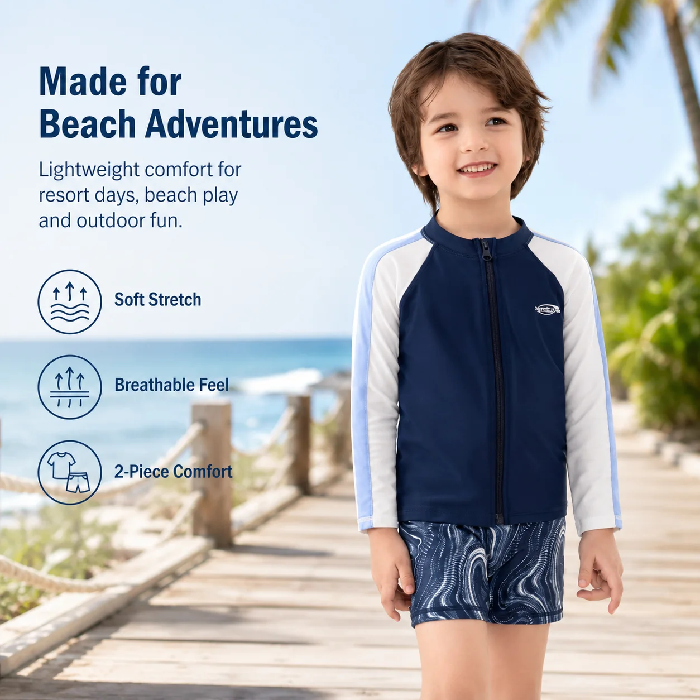
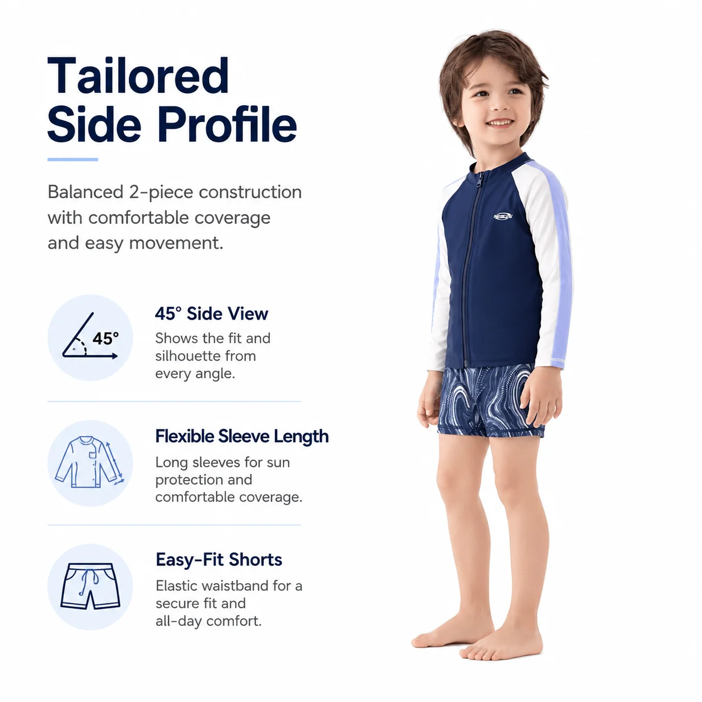

# Boys Zip-Up Rash Guard Set Wholesale: A Retail Buyer’s Decision Guide

The question at a buying meeting is rarely “Do we need another boys’ swim set?” It is usually “What will make this one easier to sell?” A **boys zip-up rash guard set wholesale** has a clear answer: it gives families a coordinated option that is quick to put on, easy to explain on the shop floor, and useful across beach, pool, and holiday shopping missions.

For retailers, that clarity matters. A rail full of similar-looking swimwear creates more decisions for the customer and more inventory risk for the buyer. The strongest zip-up rash guard set earns its place by solving a particular problem—not by being one more print or colorway.

## Give the set a job in the assortment

A zip-front style is not simply a different closure. It can be the “easy-changing” choice in a boys’ assortment: a parent can open the front rather than pull a wet top over a child’s head. That makes the format especially easy to position beside a pull-on long-sleeve set, a simpler short-sleeve option, and a one-piece rash-guard swimsuit.

Start with a plain-language product role. For example: *a coordinated, coverage-led set for active outdoor water days.* That sentence is more useful to a merchandiser than a generic claim about style, because it guides the photo, the product title, the shelf sign, and the sales conversation.

MOMASONG’s live shop groups rash guards separately and offers boys’ swimwear across age groups from 2–4 through 10–12 years. Use that breadth as a reminder to confirm the size run and color plan with the supplier before committing to an edit; a good hero style still needs a practical size curve.

## What to check before buying boys zip-up rash guard set wholesale

### 1. Make changing part of the product story

Ask the supplier how the zip is finished and how the garment is intended to be worn. Then make the benefit concrete in your own copy: “zip-front for easier changing” is easier for a customer to understand than technical language without context. Check that the garment can be opened and closed comfortably in a fitting sample, especially after movement and water play.

### 2. Build coverage into a real use case

Long sleeves are meaningful when a shopper is planning time outdoors, not as a vague extra feature. MOMASONG’s [size guide](https://momasong.com/size-guide) describes long-sleeve rash guard sets as a maximum-coverage option for outdoor beaches, while standard swimsuits suit flexible pool lessons. That distinction gives retailers a simple way to help customers choose rather than forcing one product to serve every occasion.

If your range uses UPF language, verify the exact claim for the fabric and finished product you are ordering. The site presents UPF 50+ fabric features; responsible retail copy should retain the manufacturer-supported wording and avoid adding claims that have not been confirmed for the selected style.

### 3. Look at the set as two products and one outfit

The top and shorts must work together visually, but each piece also needs to feel considered on its own. Review the proportions in a sample, the waistband experience, print placement, and how the pieces look in product photography. A coordinated set makes a fast online decision easier; a well-resolved top and short make the set feel worth keeping after the first trip.

### 4. Protect the range from near-duplicates

Avoid buying a zip-up set, a pullover set, and a standard swim top in almost the same silhouette, print, and price band. Instead, give each option a visible reason to exist. A zip-up can be the easy-change choice; a pullover can be the straightforward coverage choice; a shorter-sleeve set can be the lighter alternative. This is a more useful assortment story than adding more variants and hoping customers sort them out.

## Use the supplier conversation to reduce surprises

Before a private-label order, send a tight brief: intended customer, target activity, preferred sleeve length, size range, colors or print direction, and the labels or packaging you need. MOMASONG’s [OEM/ODM process](https://momasong.com/oem-odm) outlines a sequence from inquiry and design through sample development, production, and quality checks. That makes a sample the right place to evaluate fit, changing, and visual balance before the style becomes part of a larger order.

Also keep product claims tied to evidence. MOMASONG’s [quality page](https://momasong.com/quality) describes checks for fabric, stitching, sizing, and finished-goods details. Ask which documentation and checks apply to your selected boys rash guard swimsuit rather than assuming that every catalog statement applies unchanged to every customization.

## FAQ

### Is a zip-up rash guard set right for every boys’ swimwear customer?

No. It is strongest as one clear option in a balanced range. Families who value easy changing and coordinated coverage may prefer it, while others may choose a one-piece or a simpler swim set.

### How should retailers describe UPF 50 kids swimwear?

Use only the protection language the supplier supports for the fabric and style. Pair it with practical guidance: swimwear is one part of a wider sun-protection routine, not a reason to skip shade or other sensible precautions.

### What should a private-label brief include?

Include the intended user, style references, sizing requirements, artwork direction, labels, packaging, and the claims you plan to make. Clear inputs make sample review more productive.

## Make the next assortment decision easier

A **boys zip-up rash guard set wholesale** works best when it has a defined role: an easy-change, coordinated option for families planning active outdoor water time. Review the [MOMASONG swimwear collection](https://momasong.com/shop), compare it with your current gaps, and [contact the team](https://momasong.com/contact) with a brief for the styles you want to develop or source.
