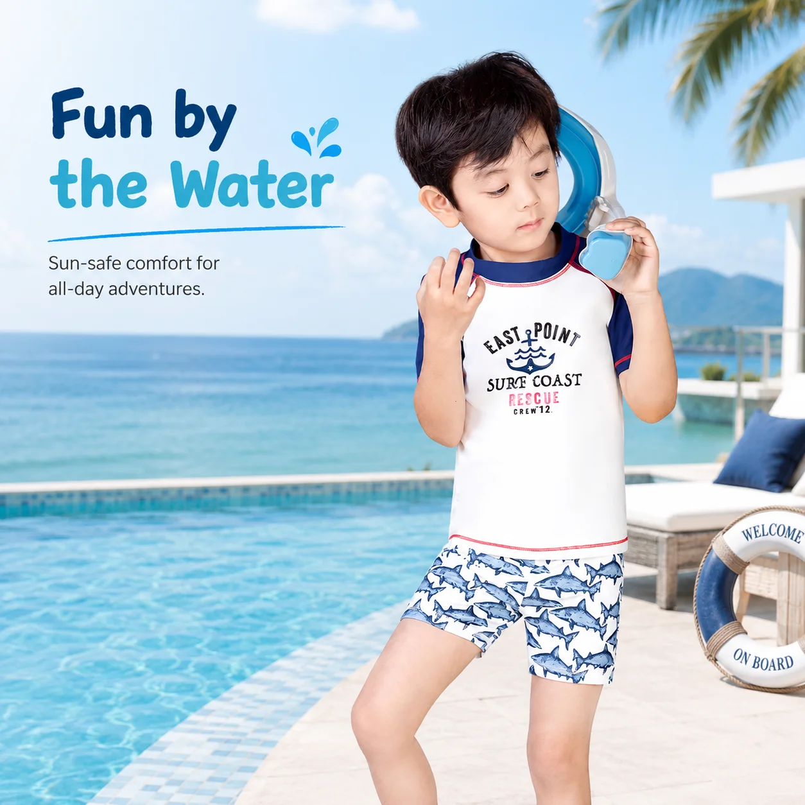
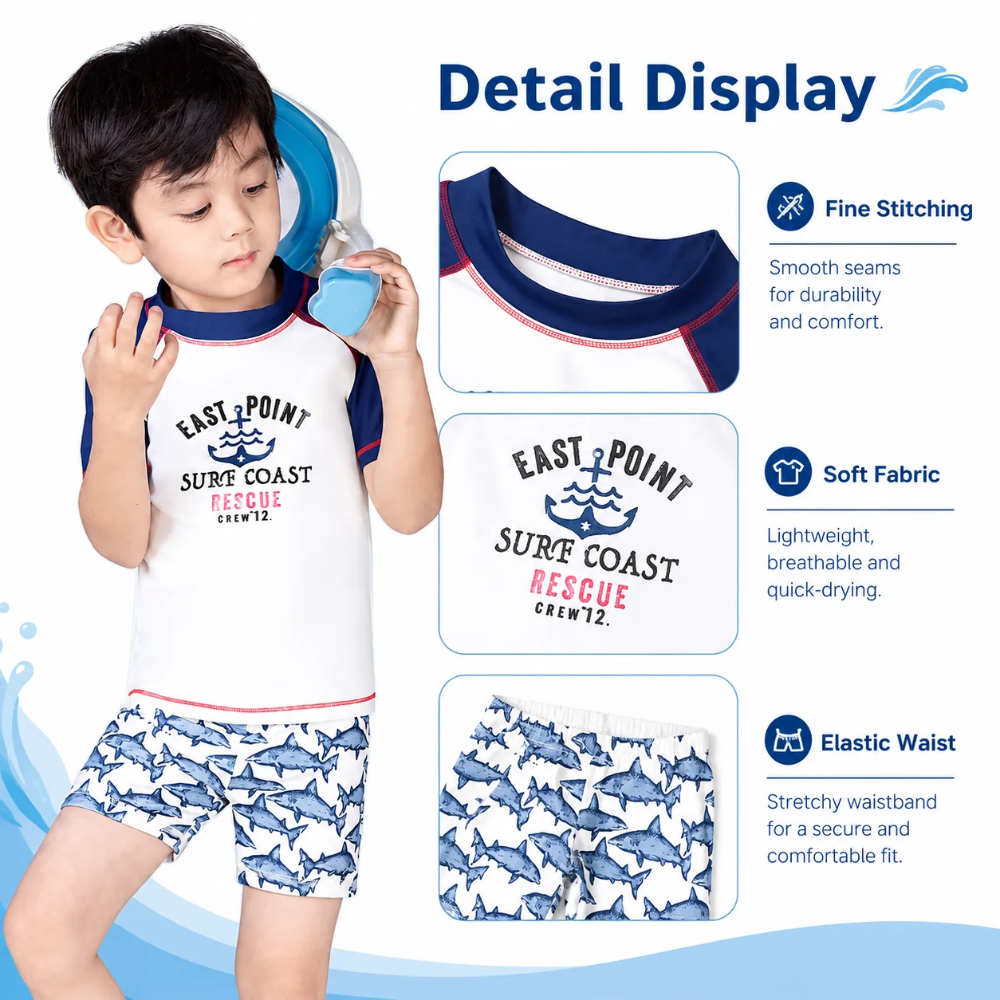

# Boys Short Sleeve Rash Guard Set Wholesale: Build a Clearer Pool Edit

The quickest way to make a boys' swim rail harder to shop is to offer three versions of the same idea without explaining the difference. A **boys short sleeve rash guard set wholesale** style can give an assortment a useful role: a coordinated option for active pool days, when families want more coverage than swim shorts alone without choosing a long-sleeve top.

That does not mean it should replace every long-sleeve set or every pair of trunks. Its value is clearer than that. It is the flexible middle option in a planned range—and it can make a retailer's choice architecture easier to understand at a glance.

## Give a boys short sleeve rash guard set wholesale style one job

Before choosing prints, define the product's job in one short sentence. For example: *a coordinated pool-day option for families who want an easy, active swim set.* That is more useful than calling every style “premium,” because it tells the merchandising team how to photograph, name and position the product.

MOMASONG’s [shop](https://momasong.com/shop) separates boys' swimwear, rash guards, one-piece swimsuits and two-piece sets. That menu is a useful reminder for buyers: formats should be distinct enough that a customer can recognize why one belongs in their basket instead of another.

For a compact edit, a short-sleeve rash guard set can be the easy pool choice, a long-sleeve set can serve shoppers seeking more coverage for extended outdoor time, and swim shorts can answer a different preference. The goal is not maximum SKU count. It is a range in which each item has a plain-language reason to exist.

## Evaluate the set in motion, not only on a hanger

A short-sleeve set makes a strong first impression when the top and shorts look intentional together. But the wholesale decision should happen after the buyer considers real movement. During a sample review, look at how the garment performs when a child reaches overhead, bends, sits and plays. Check how the neckline, sleeves, waistband and overall proportions feel together.

Fit information is part of the product, not a footnote. MOMASONG’s [size guide](https://momasong.com/size-guide) uses height, chest, waist and hip measurements, and recommends sizing up when a child is between sizes for longer wear and room to move. Carry the relevant measurements and fit notes through the product page, line sheet and wholesale conversation so retailers are not asked to infer them from a lifestyle image.

If a product brief includes a UPF claim, keep the final copy tied to the fabric and style documentation supplied for that order. MOMASONG presents UPF 50+ as a feature across its swimwear assortment; it should be communicated as supported, not expanded into unverified performance promises.

## Build the product page around the buying decision

A retailer or parent should not need to decode a product from a close-up image alone. Start the product description with the use case: pool lessons, holiday play or a warm-weather swim day. Then answer the practical questions that follow:

- Is this the short-sleeve coordinated option or part of a wider coverage story?
- What measurements and sizes should the buyer use?
- Which fabric and care guidance apply to the selected style?
- What does the print or colour story coordinate with in the wider range?

MOMASONG's fabric-care guidance advises rinsing swimwear in cold water after use, hand washing with mild detergent, avoiding bleach and softener, and hanging it to dry in shade. Retailers can use those instructions as a useful reference point, but should confirm that the same care guidance applies to the exact fabric and customized style they order.

## Use samples to settle details before the range grows

For private-label programs, a product image is only the start of the decision. The [MOMASONG OEM/ODM process](https://momasong.com/oem-odm) describes moving from an inquiry and design stage through sample development, bulk production and quality checks. Treat the sample as the point where fit, print placement, construction and product information become specific—not merely the point at which a concept is approved.

Bring a clear brief: the intended customer, use case, size run, sleeve preference, artwork direction, labels, packaging and the claims you expect to make. Ask which quality checks and documentation apply to the selected style. MOMASONG’s [quality page](https://momasong.com/quality) describes attention to fabric, stitching, sizing and finished-product checks, but a buyer should still confirm the requirements of their individual program.

This discipline also prevents an assortment from becoming a collection of near-duplicates. If the short-sleeve set is the flexible pool option, choose a separate product role for a long-sleeve kids rash guard set. When each style has a job, the range is easier to buy, explain and replenish.

## FAQ

### Is a short-sleeve rash guard set better than a long-sleeve set?

Neither is universally better. A short-sleeve set can be a flexible pool-day option, while long sleeves can serve a different coverage preference. Stock both only when each has a clear role for the customer you serve.

### What should retailers check in a boys short-sleeve rash guard set sample?

Review movement, neckline and sleeve comfort, waistband fit, measurements, print placement and the care information that will accompany the finished product. Record changes precisely before approving the next step.

### How should a retailer use a kids swimwear size guide?

Use the actual garment measurements and the supplier’s sizing guidance. MOMASONG’s guide uses height, chest, waist and hip measurements; it also advises sizing up when a child falls between sizes. Confirm the final size specification for any customized order.

## Give the next swimwear decision a clearer purpose

A **boys short sleeve rash guard set wholesale** style earns its place when it solves a visible assortment problem: it is the flexible pool option shoppers can understand quickly. Explore the [MOMASONG boys' swimwear collection](https://momasong.com/shop?cat=boys), then [contact the team](https://momasong.com/contact) with the silhouette, size range and product role you want to develop or source.
