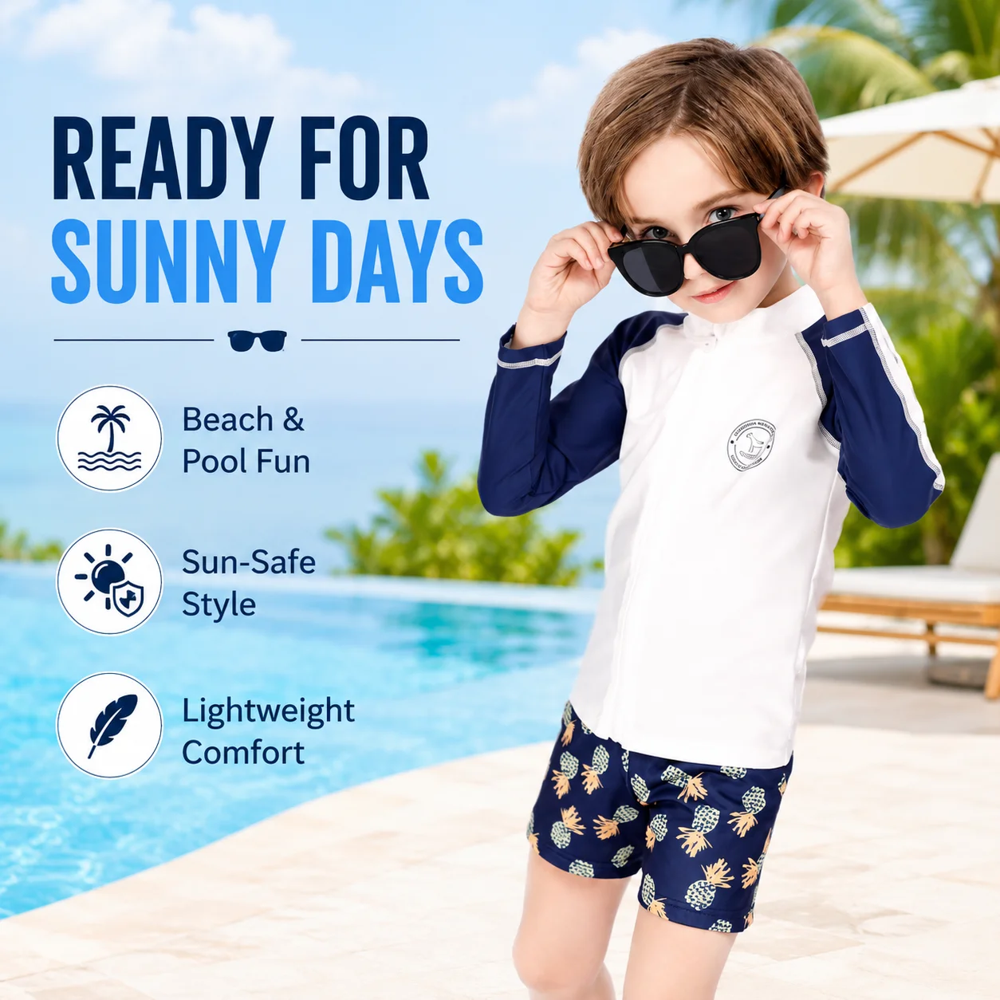
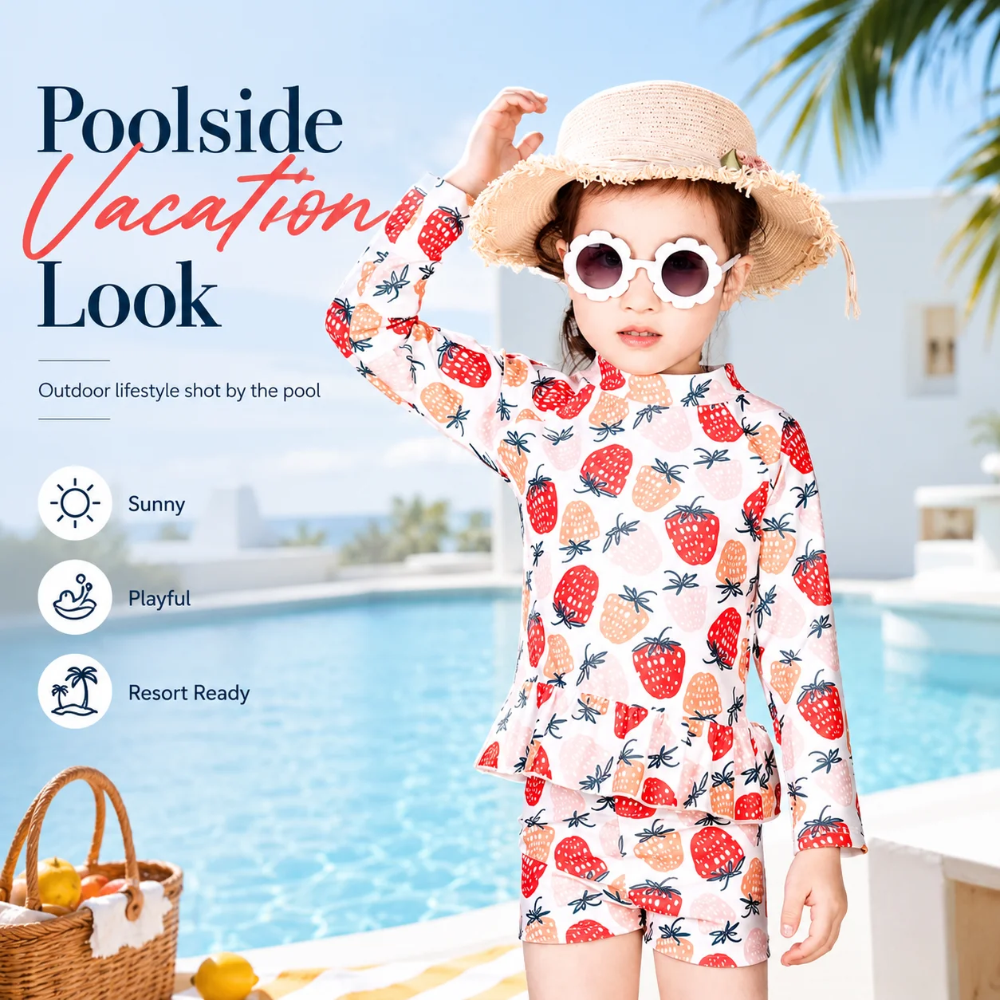

# Kids Long Sleeve Rash Guard Set Wholesale: A Smarter Assortment Plan

A long-sleeve rash guard set is easy to treat as one more box in a swimwear range. For a retailer, it can do something more useful: make a sun-conscious shopper feel that the collection anticipated the whole beach day. The challenge is keeping that promise clear without building an overstuffed rail of near-identical styles.

For buyers searching **kids long sleeve rash guard set wholesale**, the best starting point is not “which print is newest?” It is which set solves a shopper need, then how each choice earns its place beside the others. Here is a way to build an edit that is easy to buy, explain, and replenish.

## Start with the coverage story, not the colour story

Long sleeves give a set an immediate job: extra coverage for outdoor water play. That makes the category especially relevant to beach-holiday shops, resort stores, swim schools with outdoor sessions, and brands that lead with sun-aware assortments. It also gives staff a simple conversation opener: compare the coverage and activity rather than trying to sell a print in isolation.

MOMASONG’s [Rash Guards collection](https://momasong.com/shop?cat=rashguard) is organised within a wider wholesale catalogue, with filters for age group and size. Use that structure when planning your buy. A compact assortment should let a shopper move from a younger child to an older child, or from a first pool holiday to a more active beach week, without losing the visual thread of the range.

## Build a kids long sleeve rash guard set wholesale buy around three decisions

### 1. Decide where the set will be worn

Think in use cases before styles. A set positioned for beach days should make coverage and comfort easy to understand. A pool-focused offer may need to sit alongside more streamlined swim options. The [MOMASONG size guide](https://momasong.com/size-guide) describes swimwear as snug and secure while still allowing children to move, bend, and play; that is a useful standard for reviewing any set in the collection.

### 2. Make fit information do selling work

Fit uncertainty is a frequent reason shoppers hesitate online and in store. Give the long sleeve kids rash guard set its own clear size reference, not a vague age-only label. MOMASONG’s guide provides height, chest, waist, and hip measurements and advises sizing up when a child is between sizes for longer wear.

That information can become a useful retail tool: include the measurement guide on a product page, keep it at the fixture, and train staff to ask about height and activity. The goal is not to promise a universal fit; it is to help the buyer make a more confident choice before the trip or lesson begins.

### 3. Edit prints as a family

Print is often the first thing a child notices, but too many unrelated prints can weaken the collection. Choose a small visual family—perhaps ocean life, soft blue tones, or a brighter holiday story—then make sure the set still reads well when the top and shorts are seen together.

The [MOMASONG shop](https://momasong.com/shop) lists product filters for Rash Guards, age group, and size, which makes it easier to review a range as an assortment rather than as individual product pages. For a private-label collection, use the same discipline: approve a print direction, confirm the size ladder, then decide whether a coordinating accessory genuinely improves the offer.

## Ask better wholesale questions before you commit

A product photo cannot answer every buying question. Before finalising a kids rash guard set supplier, ask for the details that affect how the range will work in your channel: available size options, fabric information, care guidance, and how sets are presented or packed. Keep any claim on your product page tied to the approved specification rather than copying broad category language.

If you are developing your own range, MOMASONG outlines an [OEM/ODM process](https://momasong.com/oem-odm) that moves from inquiry and design to sample development, production, quality checks, and delivery. Its customisation page also describes print, fabric, labelling, packaging, and size-grading choices. That makes it sensible to bring a focused brief: the intended customer, a few visual references, the desired coverage level, and the size plan. A more specific brief produces a more useful discussion than “we want kids swimwear.”

For an existing assortment, ask the same commercial question at every step: will this option make a shopper’s choice easier? If it only duplicates another set’s coverage, fit, and visual role, it may be better as a reorder colour than a new SKU.

## Merchandise the set as a solution

The strongest product pages show the full outfit and then answer the next two questions: how does it fit, and where does it belong? Use a clean front view, a close look at the set relationship, and a nearby size link. On the shop floor, group long-sleeve sets with the relevant sun and water-play accessories rather than scattering them by colour alone.

This is also where a retailer can add genuine value. A short sign explaining that a long-sleeve rash guard set is a coverage-led option for water play is more useful than a technical claim that may not apply to every SKU. For approved fabric and care statements, direct customers to your product specification and to [MOMASONG’s quality information](https://momasong.com/quality).

## Frequently asked questions

### What should a retailer compare when buying long-sleeve rash guard sets?

Compare the intended activity, coverage, size range, fit guidance, approved fabric details, and how each print works within the rest of the assortment. These factors are more useful than treating every set as interchangeable.

### How many long-sleeve sets should a first swimwear edit include?

There is no universal number. Start with a focused group that covers your main age and style needs, then avoid adding designs that serve the same purpose without giving the shopper a clearer choice.

### Can a private-label brand develop a coordinated set?

MOMASONG describes custom print, fabric, branding, packaging, and size-grading options through its OEM/ODM service. Confirm the final design and specifications directly with the team before making any selling claim.

## Build the range around a clearer choice

A thoughtful **kids long sleeve rash guard set wholesale** assortment is not about offering every possible print. It is about making coverage, fit, and style easy to navigate for a family planning time in the water. To review a wholesale collection or discuss a custom direction, explore the [MOMASONG shop](https://momasong.com/shop) and [request a quote](https://momasong.com/contact) with your target age range and assortment brief.
