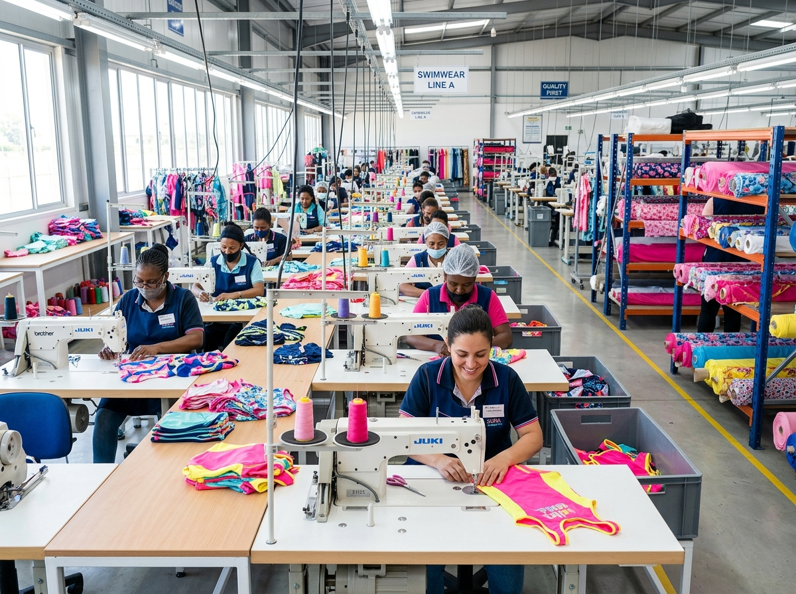

# Kids Swimwear Factory: What Retail Buyers Can Validate Before Production

A factory tour can be memorable for the wrong reasons: rows of machines, bright rolls of fabric, a sample rack full of promise. For a buyer, none of that is the real takeaway. The useful question is whether the **kids swimwear factory** has a visible way to carry one approved idea through cutting, assembly and review without losing the decisions that made the range worth buying.

That is especially important in children’s swimwear. A sleeve, print placement, size range or care-label detail can change how a set feels to a parent and how confidently a retailer can merchandise it. A production floor does not need to be a spectacle; it needs to make the handoffs legible.

MOMASONG’s published [OEM/ODM workflow](https://momasong.com/oem-odm) puts inquiry, design and quote, sample development, bulk production, quality check and delivery in sequence. Here is a practical way to use a factory conversation—and the details behind it—to ask better questions before a bulk order begins.

## Begin with the path, not the showroom

The most useful walk-through follows one style from the approved sample forward. Ask the team to explain what travels with that style: the reference sample, color or print direction, size information, branding choices and approval notes. You are looking for a shared record, not just a verbal reassurance.

This shifts the conversation from “Can you make this?” to “How will this version remain recognizable at each stage?” It also helps separate choices that are still flexible from choices that should be locked before production. A retailer may be comparing a long-sleeve rash guard set with a one-piece, for example; both can be appealing, but they can demand different decisions about merchandising, size presentation and the story on the product page.

The [MOMASONG shop](https://momasong.com/shop) shows categories including rash guards, girls’ and boys’ swimwear, two-piece sets, one-piece suits and accessories. That breadth is useful only when an assortment remains easy for a family to understand. Bring an intended assortment map to the discussion, not only individual style images.

## At a kids swimwear factory, inspect the handoff before sewing

Fabric inspection and cutting are not glamorous stages, but they reveal whether the production conversation has moved beyond the mood board. Ask how the team identifies the material and print direction for a style, and how it keeps parts intended for the same garment together. If a print has a front-facing motif or a contrast panel, request that the placement be discussed before pieces reach the sewing line.

This is not a request for a universal “perfect” setup; every project needs its own approvals. It is a request for traceable decisions. The best answer will connect the approved sample and project specifications to the practical work in front of the operators. If the answer remains broad, note the open point for the next sample or pre-production review.

## Watch for consistency, not speed alone

On a sewing line, a buyer can be tempted to judge capacity by the number of stations. For a children’s range, consistency is a more productive focus. Ask how the team handles the seams, trims and panels that are most visible on your particular style. A rash guard’s neckline, a one-piece’s strap area and a set’s coordinated print all give the buyer something concrete to examine.

MOMASONG describes its bulk-production stage as beginning after samples are approved, followed by multi-step checks for stitching, colorfastness and sizing criteria. Those are useful published checkpoints, but they are not a substitute for a brand’s own approval list. Make the list plain: which approved details should be compared, what needs a photo or a physical review, and who gives the final go-ahead.

That approach gives a private-label project a better chance of retaining its point of view. It also keeps “quality” from becoming a vague promise. The relevant standard is the one that matches the brief: a cleanly presented coordinated set, a specific print relationship or dependable sizing information for the retailer’s audience.

## Turn quality control into a buyer conversation

Quality control is most useful before a problem is found. Instead of asking only whether inspection occurs, ask what is inspected against. MOMASONG’s [quality page](https://momasong.com/quality) describes checks across the production process, and its OEM/ODM page names stitching, colorfastness and sizing criteria. Use those categories as prompts, then add the product-specific details that matter to your range.

A concise buyer checklist might include:

- The approved sample and the current bulk reference are identified clearly.
- Print, color and trim decisions have a named approval point.
- The intended size information is ready for the retailer’s selling channel; see the site’s [size guide](https://momasong.com/size-guide) for the measurements it presents.
- Branding, care information and packaging are reviewed as part of the product, not after it.
- Any difference from the approved reference is recorded and resolved before dispatch.

The point is not to turn every retailer into a factory auditor. It is to make sure the production partner and the buyer are testing the same definition of “ready.”

## A floor story should end with a clearer range

The best outcome of a **kids swimwear factory** visit is not a folder of workshop photos. It is a shorter list of unanswered questions, a realistic sequence for approvals and an assortment that will still make sense when it reaches a family-facing shelf or site.

For retailers and private-label brands, the smart next move is to send a focused brief, your intended style mix and the decisions you need to validate. Start a conversation through MOMASONG’s [contact page](https://momasong.com/contact) or review the [OEM/ODM process](https://momasong.com/oem-odm) before requesting a quote.

## Frequently asked questions

### What should I bring to a kids swimwear factory discussion?

Bring the approved visual direction, intended styles, size expectations, branding references and a list of decisions that require approval. A concise brief gives the conversation a shared starting point.

### Does a factory walk-through replace sample approval?

No. A walk-through helps clarify the process, while sample approval remains the practical moment to assess the specific style before bulk production.

### What makes this useful for a private-label range?

It helps a brand connect its labels, presentation and product details to the production stages where those choices need to be reviewed.

## Call to action

Planning a children’s swimwear range? Explore MOMASONG’s [OEM/ODM services](https://momasong.com/oem-odm) and share a buyer-ready brief for a draft review.
